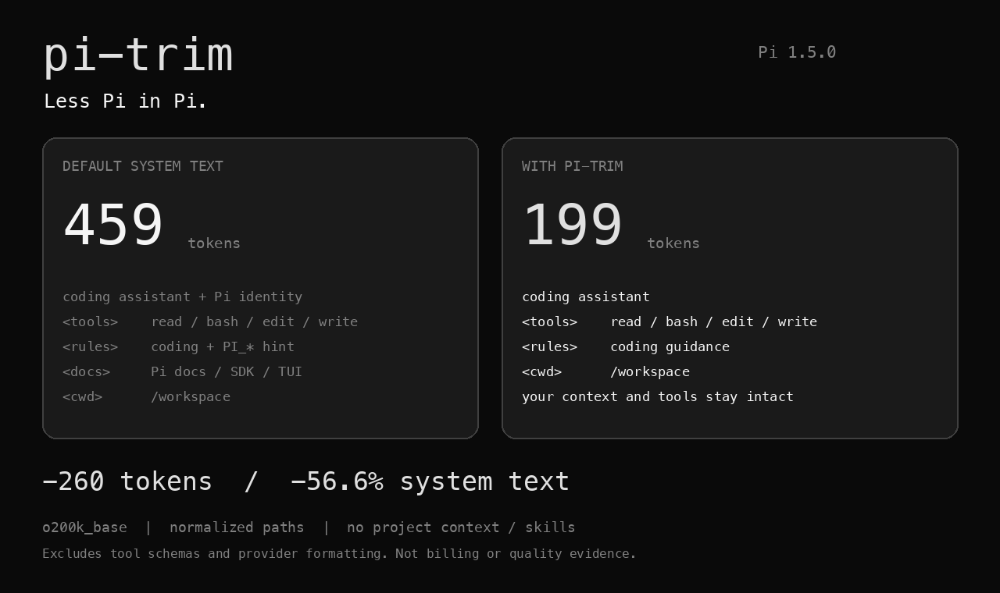
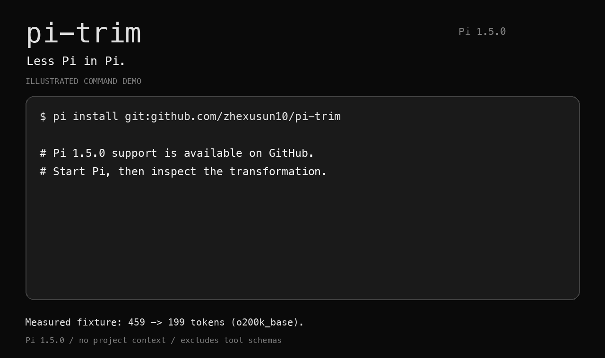

# pi-trim

**Less Pi in Pi.**

Strip Pi-specific identity and documentation from the system prompt—and optionally Pi's `<tools>` summary list with `/pi-trim mode`—while keeping the coding assistant, tool schemas, `<rules>`, and your instructions intact.

**Compatible with Pi 1.5.0** and earlier supported Pi versions (`1.0.0`, `1.4.0`). Cuts Pi 1.5.0 default system text by **56.6%** (`459 → 199` tokens) in `default` mode and **70.4%** (`459 → 136` tokens) in `aggressive` mode.

[](https://github.com/zhexusun10/pi-trim/actions/workflows/ci.yml)
[](https://www.npmjs.com/package/pi-trim)
[](LICENSE)
[](https://pi.dev)

[简体中文](docs/README.zh-CN.md) · [Measured results](benchmarks/README.md) · [Source](extensions/index.ts)



## Install

Install from npm:

```bash
pi install npm:pi-trim
# Update an existing npm installation:
pi update npm:pi-trim
```

Or install directly from GitHub:

```bash
pi install git:github.com/zhexusun10/pi-trim
```

Then start a new Pi process, or run `/reload` in an existing session.

## What changes?

What happens if Pi knows less about Pi?

Pi already keeps its default prompt small. In `default` mode, `pi-trim` removes three recognizable pieces of Pi's own boilerplate:

| Before | After |
| --- | --- |
| `You are an expert coding assistant operating inside pi, a coding agent harness.` | `You are an expert coding assistant.` |
| `You are a coding assistant running inside pi, a coding agent harness.` (introduced in Pi 1.5.0) | `You are a coding assistant.` |
| Pi's `<docs>` section: pointers to its README, SDK, extensions, themes, skills, and TUI documentation | Removed from the provider-bound system messages |
| The exact rule telling the model to inspect `PI_*` environment variables | Removed |

Tool descriptions and schemas, other rules, project instructions, skills, addenda, custom sections, and conversation messages remain intact. A user-defined docs section with different contents is preserved. This is a targeted transformation, not a filter for every occurrence of `pi` or `docs`.

Need even leaner prompts? Run `/pi-trim mode` to switch to `aggressive` mode, which also removes Pi's `<tools>` summary list (including `Additional tools may be available.`) from the system prompt because tool names, descriptions, and schemas are already declared via the API's tool definitions. `<rules>` and custom `<tools>` sections with non-Pi contents are preserved.

You can still ask the model about Pi, but its automatic documentation pointers are gone. Provide the relevant paths or links yourself when doing Pi SDK or extension work.

## Inspect and configure

```text
/pi-trim
/pi-trim status
/pi-trim diff
/pi-trim mode
/pi-trim mode default|aggressive
```

`status` reports the active mode (`default` or `aggressive`), original and remaining character counts, a **chars / 4 token estimate**, and changed sections. `diff` shows the exact removed or replaced text. `/pi-trim mode` toggles between `default` and `aggressive` (or sets the named mode directly), saves the preference to `pi-trim.json` in your Pi agent directory so it persists across new sessions, and records it on the current session branch.

Before the first model request, the command previews the base prompt. Afterwards, it describes the system text in the most recent request, including system-message updates. Tool schemas are excluded. Other extensions running later can change that request again.



The animation is an illustrated command demo, not a recording of a live model session.

## Measured prompt reduction

| Pi 1.5.0 default system text | Tokens |
| --- | ---: |
| Before | 459 |
| After (`default` mode) | 199 (-56.6%) |
| After (`aggressive` mode, also strips `<tools>`) | **136 (-70.4%)** |

Measured using `gpt-tokenizer` 4.0.0, `o200k_base`, with default read/bash/edit/write tool snippets and guidelines. Installation paths are normalized to `/opt/pi`, and the working directory to `/workspace`. No project instructions, skills, or addenda. Tool schemas and provider formatting are excluded.

These are tokenizer counts for the published fixture, not provider billing totals. Adding your project context reduces the percentage saved. Smaller prompts do not establish better task success, latency, or cost; see the [benchmark methodology and results](benchmarks/README.md).

```bash
npm ci --ignore-scripts
npm run benchmark
```

## Coding-task comparison

A historical single paired pass using Pi 1.0 over ten small JavaScript tasks with `openai-codex / gpt-6-sol`:

| Metric | Default Pi | pi-trim |
| --- | ---: | ---: |
| Task success | 10 / 10 | 10 / 10 |
| Total input tokens, including cached input | 63,903 | 50,699 (-20.7%) |
| Median first text delta (includes CLI startup) | 14.179 s | 13.673 s |
| Pi-reported model-price cost estimate | $0.090297 | $0.095274 (+5.5%) |

Aggregate tool-call counts were identical. This run does **not** establish better latency, quality, or cost: it is small, cache state was uncontrolled, and there were timing outliers. [Raw data, full metrics, and caveats](benchmarks/README.md#initial-coding-task-results).

## How it works

The extension hooks `context_with_system` before each model call. It clones recognized system messages, transforms only the relevant content or named sections, and returns the replacement messages. It preserves tool additions/removals and section-deletion markers in mid-session updates. Pi's stored transcript is not rewritten.

The extension itself makes **no network requests, telemetry, or model calls**, and never patches Pi installation files or rewrites Pi's transcript. System-prompt trimming runs purely in memory; only `/pi-trim mode` saves and reads its mode preference in `pi-trim.json` inside your Pi agent directory (`~/.pi/agent/pi-trim.json` or `$PI_CODING_AGENT_DIR/pi-trim.json`). Pi's own behavior and installation operations are separate.

The generated default prompts of **Pi 1.0.0, 1.4.0, and 1.5.0** are tested with Node.js 22.19+. The manifest follows [Pi's host-provided peer dependency convention](https://pi.dev/docs/latest/packages); it does not bundle Pi. Earlier Pi versions without `context_with_system` are unsupported. Upstream prompt changes may require new matching rules; unknown content passes through.

## Update and remove

For npm installations:

```bash
pi update npm:pi-trim
pi remove npm:pi-trim
```

For GitHub installations:

```bash
pi update git:github.com/zhexusun10/pi-trim
pi remove git:github.com/zhexusun10/pi-trim
```

Restart Pi or run `/reload` after updating or removing.

Migrating from the old `strip-pi-docs.ts` script? See the [migration guide](docs/migration.md), especially if it previously patched your Pi installation.

## Development

```bash
npm ci --ignore-scripts
npm run check
npm test
npm run benchmark
pi -e .
```

No build step or runtime dependencies. Pi loads the TypeScript extension directly. Tests cover preservation of project context, tools, custom sections, text blocks, and mid-session updates. CI also checks real Pi-generated prompts and sends a request through the Pi CLI to a local faux provider, without network access or model credentials.

For real coding-task comparisons, see [benchmarks/README.md](benchmarks/README.md). Contributions and bug reports are welcome; include the Pi version and a minimal prompt example with private content removed.

## License

MIT. An independent community package, not an official Pi product.
